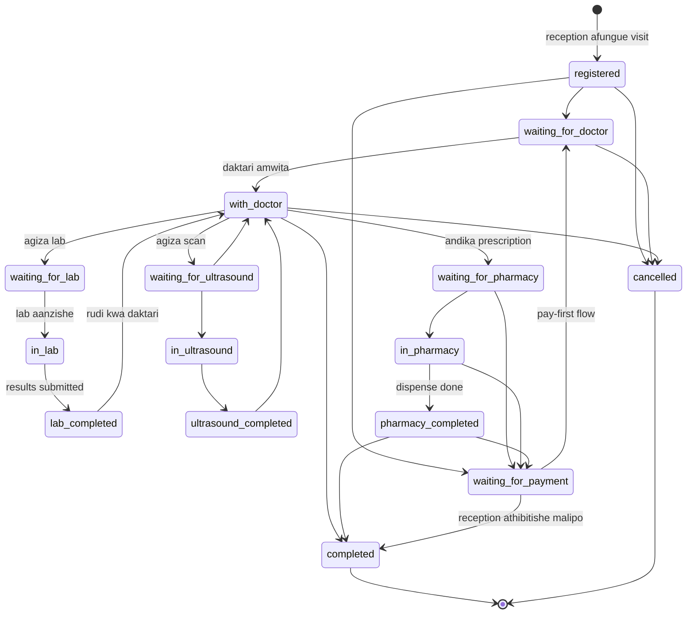
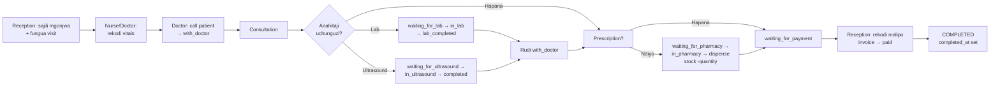
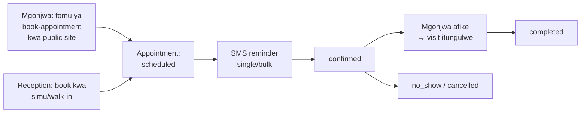
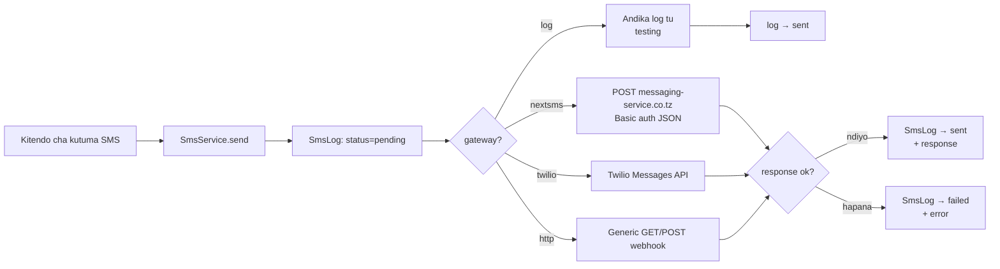
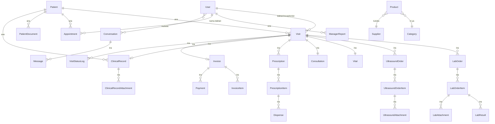

# Uzazi Clinic — Software Requirements Specification (SRS)

> **Jina la Mradi:** `drissa` · Mfumo wa Usimamizi wa Hospitali na Kliniki (Hospital & Clinic Management System)
>
> **Toleo:** 1.0 · **Tarehe:** Oktoba 2026
>
> Hati hii inaelezea mahitaji yote ya kimsingi (functional) na yasiyo ya kimsingi (non-functional), miundo ya data, na flow nzima ya mfumo — kutoka usajili wa mgonjwa hadi malipo na kufunga ziara.

---

## Yaliyomo

1. [Utangulizi](#1-utangulizi)
2. [Maelezo ya Jumla ya Mfumo](#2-maelezo-ya-jumla-ya-mfumo)
3. [Watumiaji na Wajibu Wao (User Roles)](#3-watumiaji-na-wajibu-wao-user-roles)
4. [Jedwali la Ruhusa (Access Matrix)](#4-jedwali-la-ruhusa-access-matrix)
5. [Mahitaji ya Kimsingi (Functional Requirements)](#5-mahitaji-ya-kimsingi-functional-requirements)
6. [Flow Nzima ya Mfumo](#6-flow-nzima-ya-mfumo)
7. [Muundo wa Data (Data Model)](#7-muundo-wa-data-data-model)
8. [Sheria za Biashara (Business Rules)](#8-sheria-za-biashara-business-rules)
9. [Mahitaji Yasiyo ya Kimsingi (Non-Functional Requirements)](#9-mahitaji-yasiyo-ya-kimsingi-non-functional-requirements)
10. [Mfumo wa SMS na Arifa](#10-mfumo-wa-sms-na-arifa)
11. [Ufungaji na Data ya Awali](#11-ufungaji-na-data-ya-awali)
12. [Usalama na Ukaguzi (Security & Audit)](#12-usalama-na-ukaguzi-security--audit)
13. [Mahitaji ya Mazingira (Tech Stack)](#13-mahitaji-ya-mazingira-tech-stack)

---

## 1. Utangulizi

### 1.1 Madhumuni

Hati hii ni Software Requirements Specification (SRS) ya mfumo wa **Uzazi Clinic**. Inalenga:

- **Waendelezaji (developers)** — kuelewa kile mfumo unapaswa kufanya.
- **Wadau wa kliniki** — kuthibitisha kuwa mfumo unakidhi mahitaji ya kazi za kila siku.
- **Wakaguzi/vipimo (testers)** — msingi wa kuandika test cases.

### 1.2 Wigo wa Mfumo

Uzazi Clinic ni mfumo kamili wa usimamizi wa kliniki unaofunika safari yote ya mgonjwa:

**Usajili → Triage/Vitals → Uchunguzi wa Daktari → Maabara/Ultrasound → Famasi → Malipo → Kufunga Ziara**

Mfumo una sehemu mbili kuu:

- **Tovuti ya umma (public website)** — home, about, branches, services, blog, shop, contact, na fomu ya kuweka miadi (book appointment) bila kuhitaji login.
- **Portal ya wafanyakazi (staff portal)** — workspaces kwa kila role, chat ya timu, SMS/email templates, inventory, invoices zenye PDF, na ripoti/analytics.

### 1.3 Ufafanuzi wa Maneno

| Neno | Maana |
|---|---|
| **Visit** | Ziara moja ya mgonjwa klinikini — kiini cha workflow yote |
| **MRN** | Medical Record Number — namba ya kipekee ya faili la mgonjwa |
| **State machine** | Muundo unaolazimisha hatua halali za ziara (si kuruka bila mpangilio) |
| **Soft delete** | Kufuta rekodi bila kuiondoa kabisa kwenye database |
| **Role** | Wajibu wa mtumiaji (admin, doctor, reception, n.k.) |
| **Workspace** | Ukurasa wa kazi wa role fulani baada ya login |
| **Queue** | Foleni ya wagonjwa wanaosubiri huduma katika idara |

### 1.4 Marejeo

- `SYSTEM.md` — domain specification (source of truth ya biashara)
- `routes/web.php` — ramani ya routes zote
- `app/Enums/VisitStatus.php` — state machine ya ziara
- `app/Services/VisitWorkflow.php` — utekelezaji wa transitions
- `app/Services/SmsService.php` — utekelezaji wa SMS gateways

---

## 2. Maelezo ya Jumla ya Mfumo

### 2.1 Mtazamo wa Bidhaa

Mfumo ni web application inayojitegemea (self-hosted), inayotumika kwenye kliniki moja au matawi kadhaa. Ina:

- **Public site** — inafikika na yeyote bila akaunti.
- **Staff portal** — inahitaji uthibitishaji (email + password); self-registration imezimwa.
- **Web installer** (`/install`) — wizard ya kwanza ya kuweka database na data za awali.

### 2.2 Muonekano wa Mfumo (System Map)

```
┌─────────────────────────────────────────────────────────────────┐
│                         PUBLIC WEBSITE                           │
│   Home · About · Branches · Services · Book Appointment          │
│   Blog · Shop · Contact                 (hakuna login)           │
└─────────────────────────────────────────────────────────────────┘
                              │
┌─────────────────────────────────────────────────────────────────┐
│                            LOGIN                                 │
│   Email + password · self-registration IMEZIMWA                  │
│   Password reset kupitia email                                   │
└─────────────────────────────────────────────────────────────────┘
                              │
┌─────────────────────────────────────────────────────────────────┐
│                       ACCESS CONTROL                             │
│   Kila ukurasa wa staff unahitaji login.                         │
│   Role mbaya kwenye ukurasa wa idara → soft redirect kwenda      │
│   workspace yake mwenyewe (hakuna dead end).                     │
│   Role mbaya kwenye ukurasa wa admin → "access denied".          │
│   Admin anaweza kufungua workspace ya idara yoyote.              │
└─────────────────────────────────────────────────────────────────┘
                              │
   ┌────────────┬────────────┬───────────┬───────────┬────────────┐
   ▼            ▼            ▼           ▼           ▼            ▼
┌─────────┐┌──────────┐┌─────────┐┌─────────┐┌──────────┐┌────────┐
│Reception││  Doctor  ││  Nurse  ││   Lab   ││ Pharmacy ││Ultra-  │
│Workspace││Workspace ││Workspace││Workspace││Workspace ││sound   │
└─────────┘└──────────┘└─────────┘└─────────┘└──────────┘└────────┘
                              │
                        ┌─────▼──────────┐
                        │   ADMIN PANEL   │
                        │ users·catalogs  │
                        │ reports·logs    │
                        │ settings·SMS    │
                        └─────────────────┘
```

### 2.3 Mazingira ya Uendeshaji

| Kipengele | Maelezo |
|---|---|
| Aina | Web application (browser-based) |
| Lugha ya UI | Kiingereza (staff); SMS huchanganya Kiswahili/Kiingereza |
| Fedha | Tanzanian Shilling (TSh) — inabadilishika kwenye settings |
| Eneo | Tanzania — namba za simu +255 zinahandled automatically |
| Database | Relational DB (SQLite kwa single-machine; MySQL/PostgreSQL kwa multi-user) |

### 2.4 Vizingiti na Dhana

- Watumiaji wa kawaida (wagonjwa) **hawana akaunti** — huduma zote za kliniki hufanywa na wafanyakazi kwa niaba yao.
- Mfumo unahitaji internet tu kwa kutuma SMS halisi (NextSMS/Twilio) — sehemu zingine zinaweza kufanya kazi kwenye LAN.
- Muda wa session unaisha baada ya dakika 120 (inabadilishika).

---

## 3. Watumiaji na Wajibu Wao (User Roles)

Kuna **roles 8** za wafanyakazi. Kila akaunti ina role **moja tu**; **admin** ana ruhusa ya kila kitu.

| Role | Workspace | Wajibu |
|---|---|---|
| **admin** | Dashboard + kila module | Ufikiaji kamili: users, doctors, catalogs, settings, reports, audit logs, notifications |
| **reception** | `/reception` | Kusajili wagonjwa, kufungua visits, kugawa/kubadilisha daktari, kupokea malipo, invoices |
| **doctor** | `/doctor` | Kuita wagonjwa, consultation, vitals, lab/ultrasound orders, prescriptions, kukamilisha visits |
| **nurse** | `/nurse` | Kuona foleni, kurekodi vitals, orodha ya wagonjwa |
| **lab** | `/lab` | Foleni ya lab orders, processing, kuingiza results, catalog ya tests na equipment |
| **pharmacy** | `/pharmacy` | Foleni ya prescriptions, dispensing, inventory ya dawa, ripoti za famasi |
| **ultrasound** | `/ultrasound` | Foleni ya ultrasound orders, matokeo ya scan, catalog ya services |
| **manager** | `/manager` | Ripoti za kila siku/wiki (revenue, sales, clients, expenses, challenges, action plans, signature) — system hujaza data automatically |

### Kanuni za Access Control

- **Soft redirect** — mfanyakazi akifungua ukurasa wa idara nyingine, hurudishwa kwenye **workspace yake** na ujumbe wa taarifa. Hakuna error page kwa makosa ya kawaida.
- **Hard deny** — maeneo ya admin pekee (reports, activity logs, user management, settings) yanaonyesha "access denied" kwa wasio-admin.
- **Admin override** — admin anaweza kufungua na kufanya kazi kwenye workspace ya idara yoyote (view queues, discharge visits, complete lab/payment steps).
- **Shared pages** — patient registry, clinical records, team chat, SMS composer na profile zinafunguka kwa **kila** mfanyakazi aliye-login.

**Utekelezaji:** middleware `RedirectIfWrongRole` (`redirect.role:`) hufanya soft redirects; middleware `role:admin` hufanya hard deny.

---

## 4. Jedwali la Ruhusa (Access Matrix)

| Eneo / Route | admin | reception | doctor | nurse | lab | pharmacy | ultrasound | manager |
|---|:-:|:-:|:-:|:-:|:-:|:-:|:-:|:-:|
| `/dashboard`, stats | ✅ | ✅ | ↩ | ↩ | ↩ | ↩ | ↩ | ↩ |
| `/manager/*` | ✅ | — | — | — | — | — | — | ✅ |
| `/reception/*` | ✅ | ✅ | — | — | — | — | — | — |
| `/doctor/*` | ✅ | — | ✅ | — | — | — | — | — |
| `/lab/*`, `lab-equipment`, `lab-tests` | ✅ | — | — | — | ✅ | — | — | — |
| `/ultrasound/*`, `ultrasound-services` | ✅ | — | — | — | ✅ | — | ✅ | — |
| `/pharmacy/*` | ✅ | — | — | — | — | ✅ | — | — |
| `/nurse/*` | ✅ | — | — | ✅ | — | — | — | — |
| `appointments` + SMS | ✅ | ✅ | ✅ | — | — | — | — | — |
| `patients` registry, documents, history | ✅ | ✅ | ✅ | ✅ | ✅ | ✅ | ✅ | ✅ |
| `clinical-records` | ✅ | ✅ | ✅ | ✅ | ✅ | ✅ | ✅ | ✅ |
| `chat` | ✅ | ✅ | ✅ | ✅ | ✅ | ✅ | ✅ | ✅ |
| `sms` send, logs, templates | ✅ | ✅ | ✅ | ✅ | ✅ | ✅ | ✅ | ✅ |
| `profile` | ✅ | ✅ | ✅ | ✅ | ✅ | ✅ | ✅ | ✅ |
| `/settings/*` | ✅ | — | — | — | — | — | — | — |
| `users`, `posts`, `products`, `categories`, `departments`, `clinic-rooms`, `suppliers`, `shifts`, `services` | ✅ | — | — | — | — | — | — | — |
| `admin/doctors`, `admin/queue` | ✅ | — | — | — | — | — | — | — |
| `invoices` list/show/PDF | ✅ | — | — | — | — | — | — | — |
| `/reports/*`, `/analytics`, `/activity-logs`, `/notifications` | ✅ | — | — | — | — | — | — | — |

> ✅ = ruhusa · ↩ = redirect kwenda workspace yake · — = kataliwa/redirect
>
> **Kumbuka:** reception ndiye mmiliki wa vitendo vya invoice **pay/unpay** ingawa *viewer/PDF* ya invoice ni admin-only.

---

## 5. Mahitaji ya Kimsingi (Functional Requirements)

### 5.1 Usajili na Uthibitishaji (Authentication)

| ID | Hitaji |
|---|---|
| FR-AUTH-01 | Mfumo utoe login kwa email + password; self-registration **haikubaliki**. |
| FR-AUTH-02 | Password reset itumwe kupitia email. |
| FR-AUTH-03 | Baada ya login, mtumiaji aelekezwe kwenye workspace ya role yake. |
| FR-AUTH-04 | Session iishe baada ya muda uliowekwa (default: dakika 120). |
| FR-AUTH-05 | Akaunti ziwe na flag ya `is_active` — akaunti iliyozimwa haitaweza kuingia. |

### 5.2 Reception

| ID | Hitaji |
|---|---|
| FR-REC-01 | Kusajili mgonjwa mpya (majina, DOB, jinsia, simu, national ID, anuani, allergies, blood group) — system itengeneze **MRN** automatic. |
| FR-REC-02 | Kufungua visit mpya (chief complaint, visit type) — system itengeneze **visit number** automatic. |
| FR-REC-03 | Kugawa au kubadilisha daktari wa visit. |
| FR-REC-04 | Kuona foleni ya visits zote za leo (live queue). |
| FR-REC-05 | Kupokea malipo (`POST /reception/visits/{visit}/pay`) na kurekodi Payment (amount, method, receipt). |
| FR-REC-06 | Kuweka invoice kama paid/unpaid. |
| FR-REC-07 | Kufunga (close) au kufuta (cancel) visit. |
| FR-REC-08 | Kuona call-notifications (daktari amemwita mgonjwa). |

### 5.3 Doctor

| ID | Hitaji |
|---|---|
| FR-DOC-01 | Kuona foleni ya wagonjwa wanaomsubiri (`/doctor` queue). |
| FR-DOC-02 | Kumwita mgonjwa anayefuata (`call next`) → visit huingia `with_doctor`. |
| FR-DOC-03 | Kuweka no-show kwa mgonjwa asiyejitokeza. |
| FR-DOC-04 | Kurekodi vitals (BP, temp, pulse, weight, SpO2, n.k.). |
| FR-DOC-05 | Kuandika consultation (complaint, symptoms, diagnosis, treatment plan). |
| FR-DOC-06 | Kuagiza lab tests → visit huingia `waiting_for_lab`. |
| FR-DOC-07 | Kuagiza ultrasound → visit huingia `waiting_for_ultrasound`. |
| FR-DOC-08 | Kuona lab results zilizorudi; visit hurudi `with_doctor` automatic. |
| FR-DOC-09 | Kuandika prescription (medication, dosage, frequency, duration) → visit huingia `waiting_for_pharmacy`. |
| FR-DOC-10 | Kukamilisha visit (`completed`) baada ya huduma. |
| FR-DOC-11 | Kuona schedule yake, historia ya wagonjwa, na ripoti zake. |

### 5.4 Nurse

| ID | Hitaji |
|---|---|
| FR-NUR-01 | Kuona foleni ya leo. |
| FR-NUR-02 | Kurekodi vitals kwenye visit yoyote (`POST /nurse/visits/{visit}/vitals`). |
| FR-NUR-03 | Kuvinjari orodha ya wagonjwa. |

### 5.5 Lab

| ID | Hitaji |
|---|---|
| FR-LAB-01 | Kuona foleni ya lab orders (`/lab`). |
| FR-LAB-02 | Kuanza kuchakata order (`start`) → visit huingia `in_lab`. |
| FR-LAB-03 | Kuweka results — order nzima kwa pamoja au kila test item tofauti. |
| FR-LAB-04 | Baada ya results, visit irudi `with_doctor` automatically. |
| FR-LAB-05 | Kuweka attachments (picha/PDF za matokeo). |
| FR-LAB-06 | CRUD ya lab tests catalog + import ya tests kutoka file + sample file download. |
| FR-LAB-07 | CRUD ya lab equipment na status tracking (operational/maintenance/down). |
| FR-LAB-08 | Historia ya orders zote na historia kwa kila mgonjwa. |

### 5.6 Ultrasound

| ID | Hitaji |
|---|---|
| FR-US-01 | Kuona foleni ya ultrasound orders. |
| FR-US-02 | Kuanza scan (`start`) → visit huingia `in_ultrasound`. |
| FR-US-03 | Kuweka scan findings/results → visit hurudi `with_doctor`. |
| FR-US-04 | Attachments za scan images. |
| FR-US-05 | CRUD ya ultrasound services catalog. |

### 5.7 Pharmacy

| ID | Hitaji |
|---|---|
| FR-PHAR-01 | Kuona foleni ya prescriptions (`/pharmacy`). |
| FR-PHAR-02 | Kugawa dawa (dispense) — kila dispense irekodi pharmacist na quantity; **stock ipungue automatic**. |
| FR-PHAR-03 | Baada ya dispensing, visit iende `waiting_for_payment` au `completed`. |
| FR-PHAR-04 | Inventory ya dawa: ongeza/hariri/futa medications. |
| FR-PHAR-05 | Historia ya dispensing na ripoti za famasi. |

### 5.8 Manager

| ID | Hitaji |
|---|---|
| FR-MGR-01 | Kuandika daily/weekly report (revenue, sales, clients, expenses, department reports, challenges, action plans, signature). |
| FR-MGR-02 | System ijaze taarifa automatikly (auto-suggestions kutoka data halisi). |
| FR-MGR-03 | CRUD kamili ya reports zake; admin aone reports za managers wote. |

### 5.9 Malipo na Invoices (Billing)

| ID | Hitaji |
|---|---|
| FR-BILL-01 | Visit ifikapo `waiting_for_payment`, reception arekodi malipo. |
| FR-BILL-02 | Invoice iwe na items (lines) na status (paid/unpaid). |
| FR-BILL-03 | Admin ashushwe PDF ya invoice moja au zote kwa pamoja (bulk download). |
| FR-BILL-04 | Visit iliyolipwa iweze kuwa `completed`. |

### 5.10 Appointments (Miadi)

| ID | Hitaji |
|---|---|
| FR-APT-01 | Mgonjwa aweke appointment request kupitia public site (reception haithibitishi baadaye). |
| FR-APT-02 | Staff waandame miadi: statuses `scheduled`, `confirmed`, `completed`, `cancelled`, `no_show`; types `general`, `followup`, `emergency`. |
| FR-APT-03 | SMS reminder kwa appointment moja au bulk kwa wengi. |

### 5.11 Patients, Records & Documents

| ID | Hitaji |
|---|---|
| FR-PAT-01 | Patient registry yenye live search (AJAX). |
| FR-PAT-02 | Profile ya mgonjwa: taarifa zake, visits zote, records, documents. |
| FR-PAT-03 | Upload/download patient documents — zinafikika **tu** na watu walio-login. |
| FR-PAT-04 | Patients wa-soft-delete (rejesti hazifutwi kabisa). |
| FR-PAT-05 | Historia kamili ya mgonjwa (timeline ya visits/records). |

### 5.12 Clinical Records

| ID | Hitaji |
|---|---|
| FR-CR-01 | CRUD ya clinical records zilizounganishwa na visit au appointment. |
| FR-CR-02 | "Create from visit" / "create from appointment" — record ijazwe auto kwa taarifa za context. |
| FR-CR-03 | Attachments kwenye records. |

### 5.13 Chat ya Timu

| ID | Hitaji |
|---|---|
| FR-CHAT-01 | Private/team conversations kati ya wafanyakazi. |
| FR-CHAT-02 | Unread badge + polling refresh (`chat/{id}/poll`, `chat/unread-count`). |
| FR-CHAT-03 | Membership itunze last-read time kwa kila mshiriki. |

### 5.14 Admin

| ID | Hitaji |
|---|---|
| FR-ADM-01 | Global queue — kuona visits zote; discharge, force-complete lab, force-complete payment. |
| FR-ADM-02 | Doctors management: CRUD, reset password, activate/deactivate. |
| FR-ADM-03 | Users management: CRUD kamili + bulk activate/deactivate/delete. |
| FR-ADM-04 | Catalogs: departments, clinic rooms, shifts, services, lab tests, ultrasound services, lab equipment, products, categories, suppliers, blog posts. |
| FR-ADM-05 | Reports: sales, patients, doctor performance, stock, revenue, system health. |
| FR-ADM-06 | Activity logs viewer — audit trail ya mfumo mzima. |
| FR-ADM-07 | Notifications: kutuma na kusimamia templates. |
| FR-ADM-08 | Settings: general, email, SMS (na test-send), payment. |
| FR-ADM-09 | Analytics page na dashboard KPIs/charts. |

### 5.15 Public Website

| ID | Hitaji |
|---|---|
| FR-PUB-01 | Kurasa: home, about, branches, services, blog, shop, contact — zote bila login. |
| FR-PUB-02 | Fomu ya book-appointment itengeneze appointment request. |
| FR-PUB-03 | Fomu ya contact ipokee ujumbe. |

### 5.16 Installer

| ID | Hitaji |
|---|---|
| FR-INS-01 | Wizard: welcome → database config → run setup → completion. |
| FR-INS-02 | Kabla installation haijakamilika, **traffic yote** ielekezwe kwenye installer. |
| FR-INS-03 | Baada ya kumaliza, installer ifungwe — ziara zozote kurudi site. |
| FR-INS-04 | Setup itengeneze app key, schema, na data zote za awali (§11). |

---

## 6. Flow Nzima ya Mfumo

### 6.1 State Machine ya Visit (Kiini cha Mfumo)

Visit ni **state machine** kali — kila badiliko la status lazima lithibitishwe dhidi ya jedwali la transitions, itekelezwe atomically (kwenye transaction), na liandikwe kwenye `visit_status_logs` (from → to, nani, lini, note ya hiari).



### 6.2 Jedwali la Transitions Halali

| Kutoka | Inaruhusiwa Kwenda |
|---|---|
| `registered` | `waiting_for_doctor`, `waiting_for_payment`, `cancelled` |
| `waiting_for_doctor` | `with_doctor`, `cancelled` |
| `with_doctor` | `waiting_for_lab`, `waiting_for_ultrasound`, `waiting_for_pharmacy`, `completed`, `cancelled` |
| `waiting_for_lab` | `in_lab` |
| `in_lab` | `lab_completed` |
| `lab_completed` | `with_doctor` |
| `waiting_for_ultrasound` | `in_ultrasound`, `with_doctor` |
| `in_ultrasound` | `ultrasound_completed` |
| `ultrasound_completed` | `with_doctor` |
| `waiting_for_pharmacy` | `in_pharmacy`, `waiting_for_payment` |
| `in_pharmacy` | `pharmacy_completed`, `waiting_for_payment` |
| `pharmacy_completed` | `completed`, `waiting_for_payment` |
| `waiting_for_payment` | `waiting_for_doctor`, `completed` |
| `completed`, `cancelled` | *(terminal — hakuna transitions)* |

> Transition yoyote isiyo kwenye jedwali **ikataliwe** kama invalid operation (`InvalidTransitionException`) — kamwe usiruhusu status kuruka bila mpangilio. Utekelezaji: `App\Services\VisitWorkflow::transition()` + `App\Enums\VisitStatus::allowedTransitions()`.

### 6.3 Flow ya Walk-in (Mwisho hadi Mwisho)



### 6.4 Flow ya Lab Loop

```
Doctor: agiza tests        → visit = waiting_for_lab
Lab staff: start order     → visit = in_lab
Lab staff: submit results  → visit = lab_completed → AUTO → with_doctor
Doctor: ona results        → endelea na consultation
```

### 6.5 Flow ya Ultrasound Loop

Sawa na lab kabisa: `waiting_for_ultrasound → in_ultrasound → ultrasound_completed → with_doctor`.

### 6.6 Flow ya Pharmacy Loop

```
Doctor: prescribe          → visit = waiting_for_pharmacy
Pharmacist: dispense items → visit = in_pharmacy → pharmacy_completed
                           → visit = waiting_for_payment (au completed)
```

### 6.7 Flow ya Malipo

```
visit = waiting_for_payment
  ├─ Reception: rekodi payment / mark invoice paid → visit = completed
  └─ Au: rudi waiting_for_doctor (pay-first-then-see-doctor flows)
```

### 6.8 Flow ya Appointment



### 6.9 Flow ya SMS



### 6.10 Flow ya Ufungaji (Installer)

```
/install (welcome) → /install/database (DB config)
  → /install/process → /install/run (migrations + seeders + app key)
  → /install/complete → installed flag SET → installer inafungwa milele
```

---

## 7. Muundo wa Data (Data Model)

### 7.1 Mchoro wa Uhusiano (ER Overview)



### 7.2 Entities Muhimu na Fields Zake

| Entity | Fields muhimu |
|---|---|
| **Patient** | `mrn` (unique), first/last name, DOB, gender, phone, national ID, address, allergies, blood group — **soft-deleted** |
| **Visit** | `visit_number` (unique), patient_id, doctor_id, receptionist_id, `status`, chief complaint, type, `completed_at` |
| **LabOrder / UltrasoundOrder** | visit_id, doctor_id, status; items zina test/service + results |
| **Prescription** | visit_id, doctor_id; items: medication, dosage, frequency, duration; `Dispense`: pharmacist + quantity |
| **Invoice** | visit_id, number, status (paid/unpaid); `InvoiceItem` lines; `Payment`: amount/method/receipt |
| **Appointment** | patient_id, doctor_id, `scheduled_at`, type, status, notes |
| **Vital** | visit_id — BP, temperature, pulse, weight, SpO2, n.k. |
| **ClinicalRecord** | patient_id, visit_id, doctor_id — complaint, symptoms, diagnosis, treatment plan, prescription text, notes, record date |
| **Product** | name, SKU, category, cost/selling price, quantity, reorder level, unit, active flag |
| **Setting** | key/value/`group`/`type` — store ya configuration (`general`, `email`, `sms`, `payment`) |
| **SmsTemplate / SmsLog** | template: name, slug, type, body, active · log: phone, message, status, gateway, response |
| **ManagerReport** | user_id, period (daily/weekly), revenue, sales, clients, expenses, challenges, action plans, signature |
| **VisitStatusLog** | visit_id, from_status, to_status, changed_by, note |
| **ActivityLog** | user, action, subject — audit trail ya mfumo mzima |

### 7.3 Kanuni za Data

- **Soft delete** — patients hufutwa kwa soft delete tu; rekodi hurudishwa.
- **Passwords** — huhifadhiwa hashed kila wakati; plaintext hairuhusiwi.
- **Settings** — generic key/value store iliyogawanywa kwa groups: `general`, `email`, `sms`, `payment`.
- **Files** — documents/attachments zinafikika na authenticated users pekee (route `/files/{path}` yenye `auth` middleware).

---

## 8. Sheria za Biashara (Business Rules)

| Kanuni | Maelezo |
|---|---|
| **BR-01: Visit numbers** | Format `VIS-{YYYY}-{seq}` — mfano `VIS-2026-000100` |
| **BR-02: MRN** | Format `MRN-{YYYY}-{seq}` — mfano `MRN-2026-00100` |
| **BR-03: Visit lifecycle** | Transitions za §6.2 pekee; kila badiliko liwe na audit log + user |
| **BR-04: Consultation fee** | Inabadilishika kwenye settings; default **TSh 10,000** |
| **BR-05: Fedha** | TSh — configurable |
| **BR-06: Malipo** | Pharmacy anaweza kusukuma visit kwenda `waiting_for_payment`; reception andika malipo na mark invoices paid/unpaid |
| **BR-07: Order loops** | Lab order → `waiting_for_lab`; results → rudi `with_doctor`. Sawa kwa ultrasound |
| **BR-08: Inventory** | Dispense inapunguza stock ya dawa automatic; products zina reorder level |
| **BR-09: User accounts** | Active/inactive flag; admin anaweza deactivate badala ya delete, reset passwords, bulk actions |
| **BR-10: Roles** | Roles 8 tu; akaunti moja = role moja; admin = everything |
| **BR-11: Simu** | Normalization: `0xxx…` → `+255xxx…`; NextSMS inapata `255…` bila `+` |
| **BR-12: Sender ID** | `sms_sender_id` — default `UZAZICLINIC` |

---

## 9. Mahitaji Yasiyo ya Kimsingi (Non-Functional Requirements)

### 9.1 Usalama (Security)

- Kila ukurasa wa staff unahitaji authentication; public site, login na installer tu ndizo wazi.
- Role isolation (soft redirect + hard deny) — §3, §4.
- Uploads zinafikika na logged-in users pekee.
- Passwords hashed; admin areset bila kuona ya zamani.
- Soft deletes kwa patient records.
- Secrets za gateways zihifadhiwe kwenye environment config, si code (§11.5 ilani).

### 9.2 Utendaji (Performance)

- Live search ya wagonjwa (AJAX) — majibu chini ya ~500ms kwa datasets za kliniki ya kawaida.
- Queues za idara zinaonyesha data ya sasa (refresh/polling kwa chat na call-notifications).
- PDF generation ya invoice isizuii interface (inaweza kwenda queue).

### 9.3 Uaminifu (Reliability)

- Visit transitions zote ndani ya **DB transaction** — hakuna status nusu-kubadilika.
- Kila SMS iliyotumwa iwe na log (sent/failed + response) — hakuna SMS inayopotea kimyakimya.
- Installer ilock baada ya kukamilika — haiwezi reruni.

### 9.4 Usability

- Kila role ana workspace yake — navigation iliyoboreshwa kwa kazi yake.
- Makosa ya role hayaleti dead ends — soft redirects na ujumbe wa taarifa.
- UI bilingual-friendly: staff UI English; SMS templates Swahili+English.

### 9.5 Uwezo wa Kudumisha (Maintainability)

- State machine ya visit iko mahali pamoja (`VisitStatus` enum + `VisitWorkflow` service).
- SMS gateways ni pluggable (log/nextsms/twilio/http) kupitia setting moja.
- Settings ni key/value generic — configuration mpya haihitaji schema changes.

### 9.6 Auditability

- `visit_status_logs` — historia kamili ya kila visit.
- `activity_logs` — audit trail ya mfumo mzima (admin viewer).
- `sms_logs` — kila ujumbe uliotumwa.

---

## 10. Mfumo wa SMS na Arifa

Kila SMS inaingia kwenye delivery log: `pending` → `sent`/`failed` + full gateway response. Gateway inayotumika huchaguliwa na setting `sms_gateway`.

### Gateways Zinazoungwa Mkono

| Gateway | Config keys | Maelezo |
|---|---|---|
| `log` | — | Testing — andika log bila kutuma |
| `nextsms` | `nextsms_username`, `nextsms_password`, `nextsms_from`, `nextsms_url` | Gateway ya Tanzania (messaging-service.co.tz), Basic-auth JSON POST — **ndiyo inayotumika** |
| `twilio` | `twilio_sid`, `twilio_token`, `twilio_from` | Twilio Messages API |
| `http` | `sms_http_url`, `sms_http_method` | Generic GET/POST webhook |

- **Templates** — maktaba ya templates 40+ (Swahili/English) kwa aina: registration, appointment, visit, doctor, lab, pharmacy, payment, birthday, holiday, general, reminder, marketing. Placeholders: `{{name}}`, `{{mrn}}`, `{{date}}`, `{{time}}`, `{{amount}}`, `{{phone}}`, `{{clinic}}`, n.k.
- **Bulk send** — appointment reminders kwa wagonjwa wengi kwa wakati mmoja.
- **Test SMS** — kitendo cha live test kwenye SMS settings page.
- **Email** — log-only default; template library + password-reset email zipo; SMTP halisi inabadilishika kwenye email settings.

### Settings Groups

`general` (jina la kliniki/simu/email/address/currency/fee) · `email` (mail host/from/encryption) · `sms` (gateways) · `payment` (gateway, keys, merchant, bank — default `cash`).

---

## 11. Ufungaji na Data ya Awali

### 11.1 Akaunti za Awali

Akaunti 6 huundwa kwa first run — zote password **`password`** (hashed):

| Role | Email | Password |
|---|---|---|
| Admin | `admin@drissa.test` | `password` |
| Reception | `reception@drissa.test` | `password` |
| Doctor | `doctor@drissa.test` | `password` |
| Lab | `lab@drissa.test` | `password` |
| Pharmacy | `pharmacy@drissa.test` | `password` |
| Ultrasound | `ultrasound@drissa.test` | `password` |

> Role ya `nurse` ipo lakini **haina akaunti ya default** — admin huunda manually. Production lazima ilazimishe kubadilisha password first login.

### 11.2 SMS Gateway (katika settings)

| Gateway | Key | Value |
|---|---|---|
| **NextSMS** (active) | `nextsms_username` | `Issa Scientist` |
| | `nextsms_password` | `muhas3456` |
| | `nextsms_from` / `sms_sender_id` | `UZAZICLINIC` |
| | `nextsms_url` | `https://messaging-service.co.tz/api/sms/v1/text/single` |
| Twilio / HTTP | — | *(hayajawekwa)* |

### 11.3 Email / SMTP

`mail_from`: `noreply@drissa.test` · `mail_host`: `smtp.mailtrap.io` · `mail_port`: `2525` · `mail_encryption`: `tls` · username/password: *(empty)* — mail ni log-only hadi SMTP iwekwe.

### 11.4 Payment Gateway

`payment_gateway`: `cash` (default — hakuna online gateway) · API keys/merchant/callback/bank: *(empty)*.

### 11.5 Dataset ya Awali

Departments 8 · shifts 3 (07–15, 15–23, 23–07) · clinic rooms 5 · product categories 8 · suppliers 3 · products 10 · services 6 · lab tests 6 (CBC, Malaria, Urinalysis, Blood Sugar, HIV, X-Ray) · medications 5 · lab equipment 6 · system settings ~30 · SMS templates 40+ · demo patients 4 na visits · demo appointments 14 · clinical record 1 · demo chat 1.

> ⚠️ **Tahadhari:** password ya NextSMS (`muhas3456`) imehifadhiwa plaintext kwenye default data — **ibadilishe kabla ya production**; secrets halisi ziweke kwenye `.env`, si data zilizosafirishwa.

---

## 12. Usalama na Ukaguzi (Security & Audit)

- ✅ Authentication kwa kila staff page — wazi ni public site, login, installer tu.
- ✅ Self-registration imezimwa — admin pekee anaunda akaunti.
- ✅ Role isolation — soft redirect kwa idara zingine; hard deny kwa admin areas.
- ✅ Protected files — `/files/{path}` na `auth` middleware.
- ✅ Passwords hashed; reset bila kuona ya zamani.
- ✅ Soft deletes kwa patients.
- ✅ Audit trail — `activity_logs` (global) + `visit_status_logs` (per-visit, na user aliyefanya).
- ✅ Install lock — installer haiwezi reruni.
- ✅ Secrets management — gateway passwords kwenye admin settings; production secrets kwa environment.
- ✅ Session expiry — configurable, default dakika 120.

---

## 13. Mahitaji ya Mazingira (Tech Stack)

| Kipengele | Utekelezaji |
|---|---|
| **Backend** | PHP 8.3+, Laravel ^13.8 |
| **Auth/Roles** | `laravel/ui` + `spatie/laravel-permission` + custom middleware (`redirect.role`, `role`) |
| **PDF** | `barryvdh/laravel-dompdf` (invoices) |
| **Database** | SQLite (default, file-based) — upgradeable MySQL/PostgreSQL |
| **Frontend** | Blade + Vite (npm assets) |
| **Queue** | Laravel queues (notifications); in-process fallback inakubalika |
| **HTTP client** | Laravel `Http` facade (SMS gateways) |
| **Components kuu** | `app/Enums/VisitStatus.php` (state machine) · `app/Services/VisitWorkflow.php` (transitions atomically) · `app/Services/SmsService.php` (multi-gateway SMS) · `app/Http/Middleware/RedirectIfWrongRole.php` · `app/Http/Middleware/CheckInstallation.php` |
| **Tests** | PHPUnit ^12.5 (`phpunit.xml`, `tests/`) |

### Mahitaji ya Runtime

- Relational database + writable file storage (uploads) + PDF rendering (invoices).
- Optional: background queue worker kwa notifications.
- Browser ya kisasa kwa wafanyakazi; hakuna app ya simu — mfumo ni web-based.

---

*SRS ya mfumo wa Uzazi Clinic (`drissa`) — hati rasmi ya mahitaji na flow nzima ya mfumo. Chanzo cha ukweli: `SYSTEM.md` + uandishi halisi wa code (`routes/web.php`, `app/Enums/`, `app/Services/`).*
